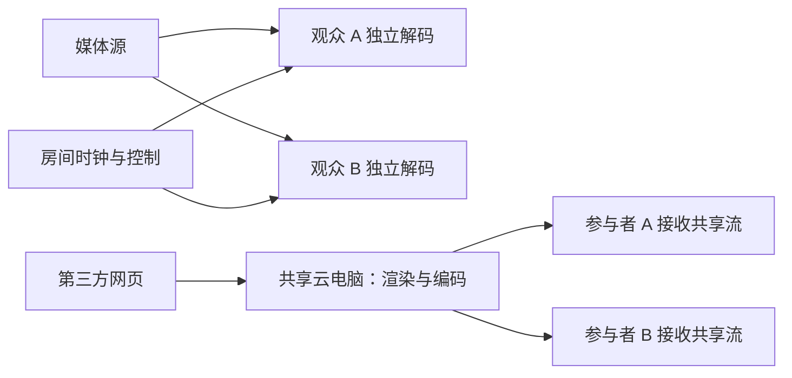

# 同步观看产品与媒体管线对比（2026-11-17）

本次研究为 [全项目审查](archive/project-review-2026-11-17.zh-CN.md) 服务。优先目标是性能、画质和浏览器兼容，比较对象为 CyTube、Syncplay、Jellyfin SyncPlay、VideoTogether、Metastream、Watch2Gether、Hyperbeam；mpv / Anime4K、hls.js 与 dash.js 作为媒体管线参考。

研究采用官方说明和固定提交源码。**没有在同一设备、同一片源下对这些产品完成端到端性能排名**；商业产品的价格、可用率、端到端延迟和当前平台支持均未亲测。下文把官方公开能力、源码机制和本项目实测分开。Metastream 的可审查实现是 v0.10.4 历史归档，不能代表其目前的商业实现。

## 1. 先比较架构和控制边界

| 产品 | 用户入口与媒体路径 | 同步权威与控制能力 | 画质处理位置 | 成本与适用场景 |
| --- | --- | --- | --- | --- |
| 本项目 | 浏览器房间；每位观众独立读取 MP4 / HLS / DASH 或平台 iframe | Node 房间权威时钟；原生视频可微调速率；有 JS API 的 iframe 依平台能力；Bilibili 只能粗同步 | 原片独立解码，客户端可选 WebGL2 / WebGPU 增强；服务器无需 GPU | 自托管 Node + Redis + PG；媒体流量来自各片源；适合开放队列与可控直链 |
| CyTube | 浏览器频道、队列、聊天；多平台播放器和直链适配 | leader / autolead 与媒体更新；客户端按 accuracy 硬跳；负时间表示起播 lead-in | 依播放器和源画质；所审同步模块没有本项目这样的增强链 | 与本项目最接近；维护平台适配与频道权限的成本较高 |
| Syncplay | 桌面客户端控制 mpv 等播放器；成员自行取得媒体 | 明确区分主动 seek 与被动漂移；支持播放器能力和 ready 状态 | 本机桌面播放器，可沿用用户的 mpv 滤镜和解码配置 | 原片不需要再次屏幕编码；需要安装客户端、匹配片源，不能直接等同浏览器房间 |
| Jellyfin SyncPlay | 自托管媒体库、Jellyfin 客户端；由 Jellyfin 提供媒体 | 组状态机、Ready / Buffering / Waiting、按未来时间安排命令 | 媒体服务器与客户端协商直放 / 转码；画质依客户端与编码策略 | 适合已有自有媒体库；需要承担媒体存储和可能的转码成本 |
| VideoTogether | 用户脚本 / 扩展接入既有网页，观众在各自网页播放 | 房间主状态外推；读取网页 video 的 currentTime、paused、rate 并修正 | 原网站解码和画质；扩展不天然取得跨域纹理读取权 | 覆盖已有网页的投入小于逐个平台新建播放器；需要站点适配、脚本权限和扩展安装 |
| Metastream 历史归档 | Web 会话 + 浏览器扩展，跨 iframe 桥接 | startTime + serverClockSkew + playbackRate；admin / DJ 权限 | 由嵌入网站播放；扩展桥接网页播放器 | 可参考隔离会话和能力探测；2024-08 后实现不再开源，历史代码不能视为当前维护基线 |
| Watch2Gether | 官方托管房间；公开介绍包括队列、聊天、Webcam、平台内容 | 官方声明同步播放器；当前私有同步算法未审查 | 依平台路径；没有取得其增强链实现的证据 | 开房无需账号，邀请流程短；运维由平台承担，可借鉴可发现性和上手流程 |
| Hyperbeam | 共享云虚拟电脑，再向参与者传输共同画面和声音 | 多人控制同一个远端浏览器 / 电脑，避免让每人操纵不同网页播放器 | 云端渲染和共享输出，用户接收流 | 无需每位观众安装扩展；增加云算力、编码与输出流量，适合无法逐站控制的内容 |

关键差别是**共享播放状态**还是**共享已经渲染的画面**。本项目、Syncplay 等允许每位观众独立解码原片；Hyperbeam 共享远端电脑，减少各客户端播放器状态差异，却引入另一条传输与编码链。两种架构的画质、成本和延迟不能用一个“支持网站数”来排名。

## 2. 同步机制逐项对照

| 机制 | 本项目现状 | 可核实的同类做法 | 应学习的具体内容 |
| --- | --- | --- | --- |
| 时钟外推 | 共用 timestamp 公式；客户端以最近 8 个 RTT 的 min / 2 修正接收锚点 | Metastream 历史实现有 serverClockSkew；VideoTogether 以 timeOffset 和消息年龄 × rate 外推；Syncplay 对 messageAge 前移 | 明确区分服务器时钟偏差、消息在途时间与播放器漂移，避免重复补偿 |
| 温和纠偏 | 300 / 150 ms 迟滞；±8%，1–3 s 漂移逐步放宽到 ±15%；保持同方向速率；8–30 s 截止 | Syncplay 固定 0.95 slow-down，低于 0.1 s 退出，持续落后才 fast-forward | 本项目已实现速率弯曲和迟滞；新增收益主要来自对真实音频连续性和收敛期限的标定 |
| 主动 seek 与被动漂移 | 房间指令先应用；周期 tick 与收到 sync 的被动硬跳阈值仍不同 | Syncplay 的 doSeek、sender 身份和 drift 路径明确分开 | 保持显式操作及时；把两个被动入口的阈值与统计口径整理为共享策略 |
| 起播就绪 | 首帧 + MP4 3 s / HLS-DASH 6 s 跑道；eligible 快照，8 s partial、20 s forced，多人 +1 s 开始 | Jellyfin Ready 校验 playlistItemId、When、位置；根据 highest ping ×2 与下界安排未来 Unpause | 在现有准备轮次上加入 RTT 和时钟不确定性预算，保留上下界，不能简单无限增加等待 |
| 缓冲等待 | 可选缓冲门，15 s 上限、后台成员排除和冷却 | Jellyfin 用 TickCount64 的 30 s 截止；重复 buffering 不续命，超时忽略阻塞成员 | 内部等待预算迁移到单调时钟，线上协议继续使用可交换的 wall-clock 时间 |
| 片源身份 | 多条异步路径已绑定 source / requestId / generation | Jellyfin Ready 的 playlistItemId 检查；CyTube update 按 media ID 重新加载 | 在所有异步字幕、弹幕、解析和诊断路径上维护同一轮次的归属检查 |
| 操作排队 | 队列内锁、同名房间锁；全局 tick 仍串行 await 房间持久化 | CyTube AsyncQueue 对任务设置 20 s 期限 | 借鉴“串行有界”，并隔离不同房间的慢 I/O；不能照抄一个队列覆盖所有房间 |
| 播放失败 | 原生媒体恢复、增强失败提示；自动播放受阻可要求手动播放 | VideoTogether 在 play Promise 失败或仍 paused 时明确提示手动播放 | 真实错误与支持状态应同时出现在当前片源 UI；不能只用保存的偏好表示成功 |

本项目并不缺“速率弯曲”“首帧握手”“请求代际”等基本机制。这些已存在，应继续完善测量、边界和共享策略，避免重复制造第二套设置或状态机。

## 3. 各产品源码中值得学习的细节

### 3.1 CyTube：最接近的开放房间产品

[播放队列](https://github.com/calzoneman/sync/blob/a6561272463367a05f83b6cc6031813ec7288f77/src/channel/playlist.js)同时处理 leader、autolead、队列恢复和更新广播；[AsyncQueue](https://github.com/calzoneman/sync/blob/a6561272463367a05f83b6cc6031813ec7288f77/src/asyncqueue.js)为排队任务设置 20,000 ms 期限。它解决的是任务串行和防止单个任务永久堵住后续操作，不等于完整取消底层 I/O。

[客户端同步](https://github.com/calzoneman/sync/blob/a6561272463367a05f83b6cc6031813ec7288f77/player/update.coffee)把负 currentTime 当加载 lead-in；媒体 ID 变化先重载，随后处理暂停 / 播放，并按 sync_accuracy seek。leader 不接受普通跟随纠偏。这种控制归属值得参考；源码中的旧 Flash / Dailymotion 特殊阈值不适合作为本项目现代浏览器参数。

本项目应学习频道权限的可解释性、队列操作的有界生命周期、明确的源身份。现有准备轮次已经比固定 lead-in 多了真实 ready 信息，继续保留该机制。

### 3.2 Syncplay：桌面播放正确性参考

[client.py](https://github.com/Syncplay/syncplay/blob/49e2a1bf36e5be1fc397c5bea14bed350609a9ed/syncplay/client.py#L373)将主动 seek、暂停、slow-down、rewind、fast-forward 分开；自己发出的控制不会又被当作他人纠偏重做。fast-forward 要求持续检测到落后，slow-down 依赖播放器 speedSupported，进入与退出使用不同阈值。

这里的价值是**行为的归属、迟滞和持续证据**。本项目已保持同方向微调，不需要再次实现一个固定 0.95 模式。Syncplay 的桌面播放器能力更强，也没有网页 iframe 的同源限制；不能因为它配合 mpv 能运行复杂滤镜，就认定浏览器必须复制全部管线。

### 3.3 Jellyfin SyncPlay：准备、等待与未来起播

[Group.cs](https://github.com/jellyfin/jellyfin/blob/07bcec2e1f4e835bc3a667c856dd444ec46b4611/Emby.Server.Implementations/SyncPlay/Group.cs)使用 Environment.TickCount64 维护等待截止，默认 30 s；ping 会 clamp 到 0–10,000 ms。重复的 buffering 事件不延长原有截止；到期后处理仍阻塞的成员，避免全组无限等待。

[WaitingGroupState.cs](https://github.com/jellyfin/jellyfin/blob/07bcec2e1f4e835bc3a667c856dd444ec46b4611/MediaBrowser.Controller/SyncPlay/GroupStates/WaitingGroupState.cs#L412)先验证 playlistItemId，再按客户端 When 校准位置；暂停客户端不累加消息年龄。seek 之后的 ready 与播放中缓冲恢复允许的偏差不同，最后根据延迟或 highest ping ×2 和 DefaultPing 安排未来的 Unpause。

可实施方向是把本项目固定 +1 s 起播改为**有上下界的网络预算**，以及把内部截止从 Date.now 改为 monotonic。不能机械复制 Jellyfin 的 30 s、500 ms 或最高速率：本项目面对第三方媒体与不同浏览器，参数应由本项目的多机实测决定。

### 3.4 VideoTogether：既有网页和诚实的自动播放处理

[vt.js](https://github.com/VideoTogether/VideoTogether/blob/3c61f12b84523abed497f690754487b5c21ec6d3/source/extension/vt.js#L3447)按 currentTime + 消息年龄 × playbackRate 外推；成员同步限至每秒一次。播放中差异超过 1 s 才 seek，暂停时阈值是 0.1 s，waitForLoadding 可让其他成员等待。play 失败或调用后仍暂停时提示手动播放。

该实现说明暂停时可比播放中更严格、网页播放器必须检查实际状态；也表明扩展有另一种平台覆盖路径。扩展能接触页面 video，不意味着它能绕过 CORS 读取像素、DRM 或获取任意 iframe 的内部 API。本项目可将扩展桥接作为独立方案研究，不能把它冒充普通网页已经拥有的能力。

### 3.5 Metastream：仅学习可审查的历史实现

当前 [README](https://github.com/samuelmaddock/metastream/blob/06f56f1576451b073e2adba45e437ee007332048/README.md)说明 2024-08 起不再开源。此次使用 v0.10.4 对应的归档提交 `f49bdada5bbb37391bc709988350fe4347c671c0`：

- [mediaPlayer.helpers.ts](https://github.com/samuelmaddock/metastream/blob/f49bdada5bbb37391bc709988350fe4347c671c0/packages/metastream-app/src/lobby/reducers/mediaPlayer.helpers.ts)用 startTime + serverClockSkew 与 playbackRate 计算当前时刻，并按 admin / DJ 限制播放权限。
- [mediaSessionObserver.ts](https://github.com/samuelmaddock/metastream/blob/f49bdada5bbb37391bc709988350fe4347c671c0/packages/metastream-app/src/lobby/mediaSessionObserver.ts)先探测 mediaSession 和 setPositionState，并在外围捕获失败。
- [扩展文档](https://github.com/samuelmaddock/metastream/blob/f49bdada5bbb37391bc709988350fe4347c671c0/docs/extensions.md)提供理解跨 iframe 播放器桥接的历史入口。

值得学习的是能力探测与隔离桥接；历史 MediaSession 示例也有固定 playbackRate 等限制，不能原样照搬。现今支持网站、维护状态和体验不从这份归档推断。

### 3.6 Watch2Gether：借鉴短流程和功能可发现性

[官方首页](https://w2g.tv/en/)公开列出无需账号创建房间、分享邀请、同步视频 / 音频、聊天、队列和 Webcam，并提供 Chrome、Firefox、Opera、Edge 扩展入口。页面提及 Netflix、Amazon、Disney 等，首页没有充分区分每个平台的进入路径和限制，因此本报告不把它们直接计作免扩展原生嵌入覆盖。

可学习的产品行为是让“创建 → 分享 → 开始”清楚可见，以及用帮助说明各类源的限制。本项目已有邀请入口和部分翻译标识，下一步应补齐**当前源可控程度、增强是否生效、自动播放是否受阻**，而不是继续堆叠同名开关。其同步精度、持续流畅度与音视频通话质量未亲测。

### 3.7 Hyperbeam：共享云电脑是可选架构

[官方首页](https://hyperbeam.com/)区分 Watch Party Platform（入口为 watch.hyperbeam.com）和 Virtual Computer API，公开宣称多人共同操纵远端 Chrome / Android / Linux 环境、无需下载或扩展、访问控制、移动触摸与云端 WebGL 支持。这些是官方公开能力；“flawlessly”“所有网站”等营销措辞不构成本次实测结论。

共享云电脑能减少平台 iframe 控制限制，但服务成本由虚拟电脑运行、编码和参与者输出共同组成，原片还经过共享输出链。适合无法控制原网站的可选房间模式，不宜替换本项目低服务器成本的直链架构。本次未运行商业会话、未验证 DRM 和分辨率，也不引用页面动态价格计算器作为精确费用承诺。

## 4. 画质与缓冲应向媒体工具学习什么

| 参考 | 已有实现与证据 | 本项目的改善方向 |
| --- | --- | --- |
| mpv / Anime4K | [Anime4K v4.0.1](https://github.com/bloc97/Anime4K/tree/v4.0.1)提供不同网络与目标尺寸闸门；本项目 GLSL 由脚本生成，保留权重 | 对齐同一网络、同一段视频、同一目标尺寸后再比画质；“AI”名称、边缘能量和 pass 数都不能单独证明更好 |
| AMD FSR1 | [官方 EASU / RCAS 源码](https://github.com/GPUOpen-Effects/FidelityFX-FSR/blob/master/ffx-fsr/ffx_fsr1.h) | 本项目清晰化是 EASU + 自有邻域限幅锐化，不能把后段叫 AMD CAS 或官方 RCAS；维持准确命名 |
| hls.js | [1.6.12 API](https://github.com/video-dev/hls.js/blob/v1.6.12/docs/API.md)区分前向时间目标、最大值和字节预算 | 保留深缓冲；字节预算按设备能力，后台页按可见性策略；直播交由 live-edge 机制 |
| dash.js | [5.0.3 Settings](https://github.com/Dash-Industry-Forum/dash.js/blob/v5.0.3/src/core/Settings.js)分别定义 normal / top-quality / long-form buffer | 三个目标已同步并即时响应同一偏好；继续补齐与 HLS 对等的内存和隐藏页策略 |
| 浏览器平台 | [rVFC](https://developer.mozilla.org/en-US/docs/Web/API/HTMLVideoElement/requestVideoFrameCallback)、[GPUDevice.lost](https://developer.mozilla.org/en-US/docs/Web/API/GPUDevice/lost)、[CORS](https://developer.mozilla.org/en-US/docs/Web/HTTP/Guides/CORS) | 解码帧回调、GPU 提交、GPU 完成和最终合成是不同测量层；能力必须真实探测并有可见失败路径 |

本项目本轮同源实测中，WebGL S 链为 10 个 pass（含最终呈现），质量链为 47 个，纹理申请存储分别约 59.77 / 390.23 MiB。质量链成本不能以“55 段 shader”或“仅多几个预设 pass”推断。WebGPU 与 WebGL2 的融合方式不同，跨后端也不能只数 API pass 就下结论。完整测量方法与数据见审查报告。

当前没有同机、当前版本 mpv 的完整公平复测；历史 [WebGL2 与 mpv 对齐记录](upscale-webgl2-mpv-parity.zh-CN.md)只作为历史证据。**本轮不宣称画质超过 mpv、Jellyfin 或任何商业产品。**

## 5. 已吸收的改善与后续学习路线

| 状态 | 学习内容 | 本次落地或后续验收 |
| --- | --- | --- |
| 已落地 | 能力由运行时决定，失败要可见 | Direct CORS 回退与 iframe 源禁用不可用的增强操作，保留全局偏好；Chrome / Firefox 验证 |
| 已落地 | 帧调度与资源跟随播放器生命周期 | 共用 rVFC 循环、暂停 / seek / resize 重绘、代际取消、设备丢失回退、CNN 闲置目标释放 |
| 已落地 | 共享设置、缓冲目标与取消责任 | DASH 三目标即时更新；Edge probe 用 AbortController；Grafana 查询取消关闭连接与 HTTP 订阅 |
| 已落地 | 有界串行与请求身份 | 同名房间装载锁、首帧回执等待成员建立、SponsorBlock 脱离全局 tick 并绑定片源 |
| 下一批 P1 | 真实 GPU 完成与内存预算 | 在同源持续播放下记录增强完成时间、在途提交、资源高水位、p95 截止失约；不得把 video rVFC 当增强完成帧率 |
| 下一批 P1 | 房间间 I/O 隔离和落盘合并 | 注入一间慢 DB 房间，其余房间 tick / pause / seek 不受拖累；减少 prevQueue 写放大并保持恢复暂停 |
| 下一批 P1 | Chrome / Firefox 真机覆盖 | Windows 双浏览器、Android、iOS / Safari 的首帧、CORS、全屏、字幕、语音、持续负载矩阵 |
| 独立设计 P2 | RTT 预算起播、单调截止 | 比较 fixed +1 s 与有界 RTT 预算；注入系统时钟跳变、丢包、后台成员和新加入者，验证无无限等待 |
| 独立选项 P2 | 扩展桥接 / 云共享房间 | 先列确有需求但当前不能控制的网站，再估算桥接维护成本或云计算 / 编码 / 流量；不预设替换架构 |

详细完善清单以 [全项目审查](archive/project-review-2026-11-17.zh-CN.md) 的编号为准；这里记录学习依据与决策理由。成本估计和平台能力应在实际实施时再次核实。
